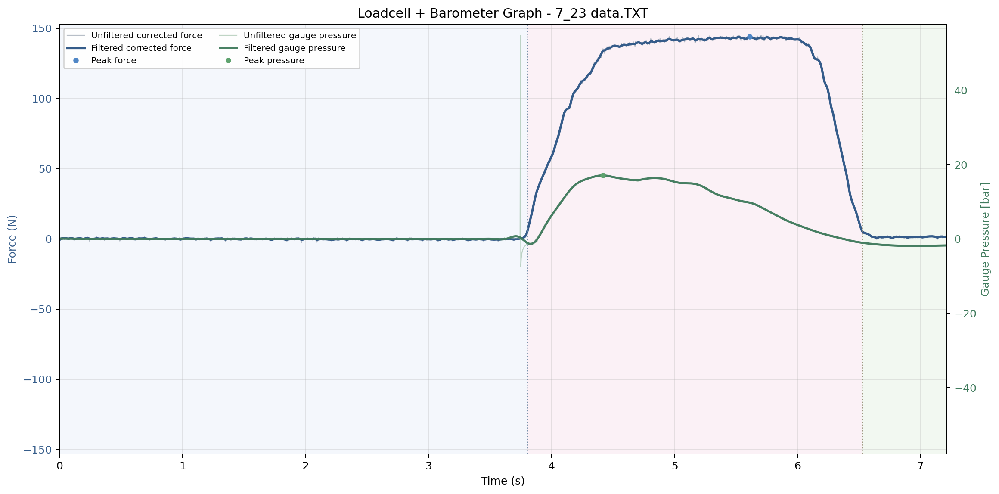
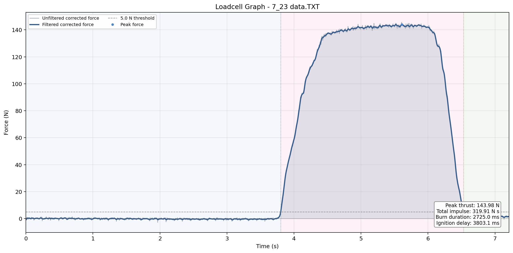
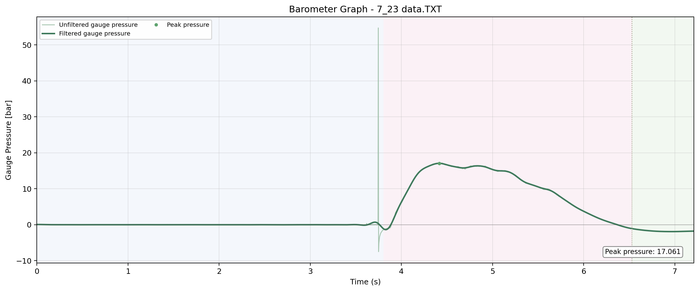

# 2026년 7월 23일 연소 시험

## Reference Figures

### Combined Plot

### Loadcell Plot

### Barometer Plot

## Metrics

| 항목 | 값 |
|---|---|
| 입력 파일 | TMS/Data/2026/7_23/7_23 data.TXT |
| 샘플링 속도 | 320 sps |
| 점화 지연 | 3803.1 ms |
| 연소 시간 | 2725.0 ms |
| 최대 추력 | 143.98 N |
| 평균 추력 | 117.40 N |
| 총 임펄스 | 319.91 N s |
| 최대 압력 | 17.061 bar (suspect) at 4.416 s |

## 시험 조건 및 데이터 처리

| 항목 | 값 |
|---|---|
| 샘플링 속도 | 320 sps |
| 드리프트 보정 | Constant baseline offset |
| 로드셀 임계값 | 5.00 N (고정 절대값) |
| 추력 필터 | Butterworth low-pass 20.0 Hz, order 2 |
| 압력 필터 | Butterworth low-pass 5.0 Hz, order 4 |
| 압력 기준 오프셋 | 9.380857 bar |
| 로드셀 기준 오프셋 | -21.083218 N |
| 로드셀 기준 구간 | 0.000000 to 1.900000 s (608 samples) (점화 전 raw force) |
| 압력 기준 구간 | first 0.500 s (up to 160 samples, filtered pressure) |
| 연소 구간 | 필터링 추력의 첫 5 N 교차부터 마지막 5 N 교차까지 |

## Calibration

| 항목 | 값 |
|---|---|
| 로드셀 보정 기울기 | -0.039100 kg/ADC |
| 로드셀 보정 절편 | -193.0049 kg |
| 로드셀 보정 R² | 0.999948 |
| 압력 변환식 | y = 0.0027x -0.11 |

## Issues

- 압력 채널: 시작 시 9.38 bar 오프셋, 추력이 상승 중인 4.42 s에 17.06 bar로 최대, 추력이 140-144 N으로 유지되는 동안 약 10 bar까지 하강, 연소 후 시작 수준보다 약 5 bar 낮게 안정. 의심 데이터로 표시하며 추력 값에는 영향이 없습니다.
- 당일 보정 기록(calidata)은 R² 0.88로 사용하지 않았으며 기존 보정값을 적용했습니다.

## Test Video

- 공개된 영상 링크 없음.

## Result Files

- [Executive Report](./files/2026-07-23_tms-7_executive_report.txt)
- [Pipeline Data](./files/2026-07-23_tms-7_pipeline_data.txt)
- [Quality](./files/2026-07-23_tms-7_quality.json)
- [Raw recording](./files/2026-07-23_tms-7_raw.txt)

## Processing provenance

Processed on 2026-11-23 with `Calibration/tms_data_pipeline.py` at TMS commit `0604925` (fixed 5 N threshold, inherited calibration). Raw SHA-256 `fdd4bb0d7785d4c3ab3c04bf4fd48102f0f57344141423122cc9c5b8abad650b`.
