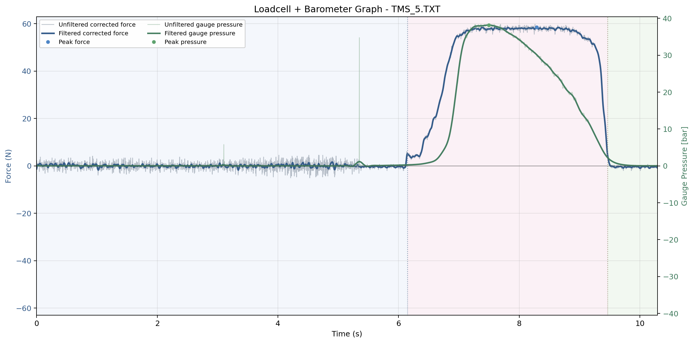
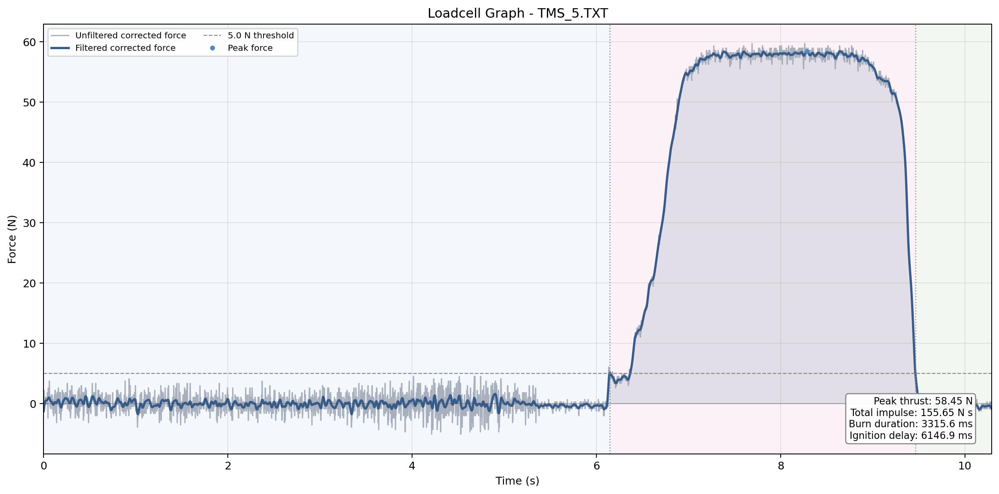
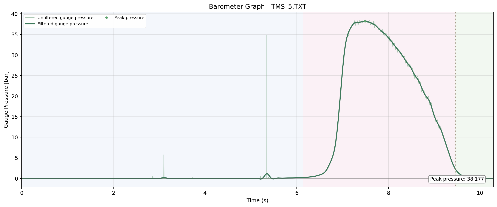

# 2026년 7월 24일 연소 시험

## Reference Figures

### Combined Plot

### Loadcell Plot

### Barometer Plot

## Metrics

| 항목 | 값 |
|---|---|
| 입력 파일 | TMS/Data/2026/7_24/TMS_5.TXT |
| 샘플링 속도 | 320 sps |
| 점화 지연 | 6146.9 ms |
| 연소 시간 | 3315.6 ms |
| 최대 추력 | 58.45 N |
| 평균 추력 | 46.94 N |
| 총 임펄스 | 155.65 N s |
| 최대 압력 | 38.177 bar (suspect) at 7.494 s |

## 시험 조건 및 데이터 처리

| 항목 | 값 |
|---|---|
| 샘플링 속도 | 320 sps |
| 드리프트 보정 | Constant baseline offset |
| 로드셀 임계값 | 5.00 N (고정 절대값) |
| 추력 필터 | Butterworth low-pass 20.0 Hz, order 2 |
| 압력 필터 | Butterworth low-pass 5.0 Hz, order 4 |
| 압력 기준 오프셋 | 0.040564 bar |
| 로드셀 기준 오프셋 | -21.442631 N |
| 로드셀 기준 구간 | 0.000000 to 3.184375 s (1019 samples) (점화 전 raw force) |
| 압력 기준 구간 | first 0.500 s (up to 160 samples, filtered pressure) |
| 연소 구간 | 필터링 추력의 첫 5 N 교차부터 마지막 5 N 교차까지 |

## Calibration

| 항목 | 값 |
|---|---|
| 로드셀 보정 기울기 | -0.039100 kg/ADC |
| 로드셀 보정 절편 | -193.0049 kg |
| 로드셀 보정 R² | 0.999948 |
| 압력 변환식 | y = 0.0027x -0.11 |

## Issues

- 낮은 추력: 최대 58 N으로 다른 2026년 시험(144-324 N)보다 크게 낮고 연소는 3.3 s입니다. 로드셀 포화는 아니며, 다른 모터인지 하중 경로 문제인지는 기록으로 확인되지 않습니다.
- 압력 채널: 7.49 s에 38.2 bar로 최대 후 추력이 57-58 N으로 유지되는 동안 8.75 s까지 약 19 bar로 하강하며, 2026-07-23과 같은 양상입니다. 의심 데이터로 표시합니다.

## Test Video

- 공개된 영상 링크 없음.

## Result Files

- [Executive Report](./files/2026-07-24_tms-5_executive_report.txt)
- [Pipeline Data](./files/2026-07-24_tms-5_pipeline_data.txt)
- [Quality](./files/2026-07-24_tms-5_quality.json)
- [Raw recording](./files/2026-07-24_tms-5_raw.txt)

## Processing provenance

Processed on 2026-11-23 with `Calibration/tms_data_pipeline.py` at TMS commit `0604925` (fixed 5 N threshold, inherited calibration). Raw SHA-256 `489768aa9822dd1b8975ce49be39c10e1bc4916cabd0b0f0b774dbe6eaf846dd`.
