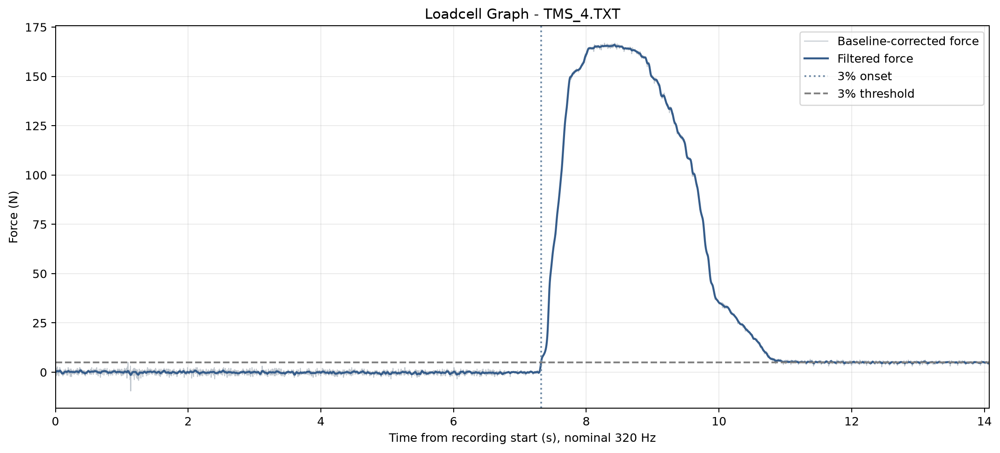
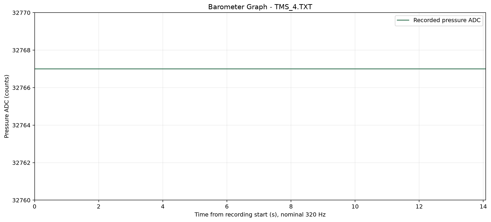

# 2026년 10월 13일 연소 시험

## Reference Figures

### Combined Plot

### Loadcell Plot

### Barometer Plot

## Metrics

| 항목 | 값 |
|---|---|
| 입력 파일 | TMS/Data/2026/10_13/TMS_4.TXT |
| 샘플링 속도 | 320 sps |
| 점화 지연 | 7321.9 ms |
| 연소 시간 | 6753.1 ms |
| 최대 추력 | 166.01 N |
| 평균 추력 | 54.82 N |
| 총 임펄스 | 370.22 N s |
| 최대 압력 | Unavailable |

## 시험 조건 및 데이터 처리

| 항목 | 값 |
|---|---|
| 드리프트 보정 | Constant baseline offset |
| 로드셀 임계값 (3%) | 4.98 N |
| 추력 필터 | Butterworth low-pass 20.0 Hz, order 2 |
| 압력 필터 | Butterworth low-pass 5.0 Hz, order 4 |
| 로드셀 기준 오프셋 | -12.022081 N |
| 로드셀 기준 구간 | 0.000000 to 3.659375 s (1171 samples) |
| 연소 구간 | First to last crossing of 3% peak filtered thrust |

## Calibration

| 항목 | 값 |
|---|---|
| 로드셀 보정 기울기 | -0.039100 kg/ADC |
| 로드셀 보정 절편 | -193.0049 kg |
| 로드셀 보정 R² | 0.999948 |
| 압력 변환식 | y = 0.0027x -0.11 |

## Test Video

<video controls playsinline preload="metadata" poster="./files/2026-10-13_tms-4_video_poster.jpg" style="max-width:100%;max-height:70vh"><source src="./files/2026-10-13_tms-4_video.mp4" type="video/mp4"></video>

[Watch video](./files/2026-10-13_tms-4_video.mp4) · [Download original](./files/2026-10-13_tms-4_video_original.mp4)

## Result Files

- [Executive Report](./files/2026-10-13_tms-4_executive_report.txt)
- [Pipeline Data](./files/2026-10-13_tms-4_pipeline_data.txt)
- [Raw recording](./files/2026-10-13_tms-4_raw.txt)
