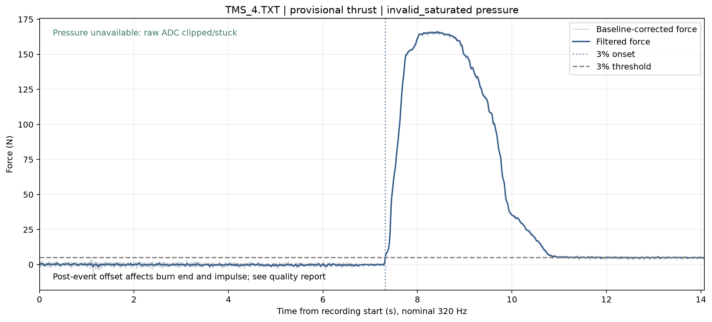
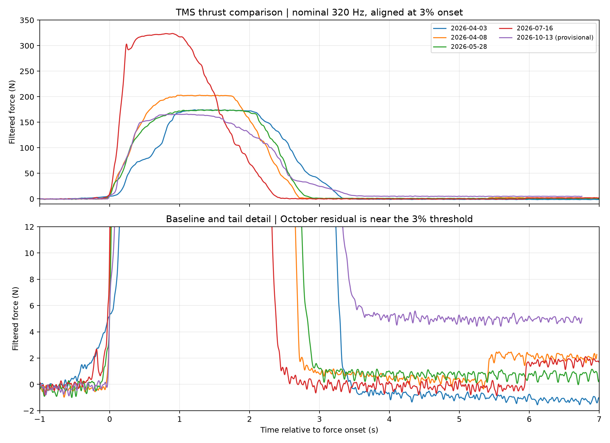

# 2026년 10월 13일 연소 시험

One clear thrust event: 166.01 N peak and 370.22 N s impulse (provisional). Pressure unavailable; burn duration unvalidated.

## Data quality

Provisional thrust. Pressure unavailable. Burn duration and average thrust unvalidated; see data review.

TMS_4 is the only clear thrust event. All five original files are retained below; idle/startup files are not counted as separate static fire tests.

## Metrics

| Metric | Value | Status |
|---|---|---|
| Peak thrust | 166.01 N | Provisional; inherited calibration |
| Total impulse | 370.22 N s | Provisional; residual baseline and end-window sensitivity |
| Force onset from recording start | 7.321875 s | Nominal 320 Hz; not verified command latency |
| Burn duration / average thrust | Unavailable | Last 3% crossing is the last sample |
| Pressure | Unavailable | Every pressure ADC sample is 32767 |

## Reference Figures

## Test Video

<video controls playsinline preload="metadata" poster="./files/2026-10-13_tms-4_video_poster.jpg" style="max-width:100%;max-height:70vh"><source src="./files/2026-10-13_tms-4_video.mp4" type="video/mp4"></video>

[Watch browser video](./files/2026-10-13_tms-4_video.mp4) · [Download original video](./files/2026-10-13_tms-4_video_original.mp4). The video has no shared trigger/time reference with the data logger. Plume duration is not a thrust measurement.

## Result Files

- [Data review and previous-TMS comparison](./files/2026-10-13_analysis.md)
- [Executive report](./files/2026-10-13_tms-4_executive_report.txt)
- [Pipeline data with original ADC columns](./files/2026-10-13_tms-4_pipeline_data.txt)
- [Quality and processing provenance](./files/2026-10-13_tms-4_quality.json)
- [Session inventory and SHA-256 hashes](./files/2026-10-13_session_manifest.json)
- [Machine-readable comparison](./files/2026-10-13_comparison.json)

## Raw recordings

- [TMS_1.TXT — startup_probe](./files/2026-10-13_tms-1_raw.txt)
- [TMS_2.TXT — no_event](./files/2026-10-13_tms-2_raw.txt)
- [TMS_3.TXT — startup_probe](./files/2026-10-13_tms-3_raw.txt)
- [TMS_4.TXT — thrust_event](./files/2026-10-13_tms-4_raw.txt)
- [TMS_5.TXT — no_event](./files/2026-10-13_tms-5_raw.txt)

## Processing

Main pipeline: `TMS/Calibration/tms_data_pipeline.py`; inherited loadcell calibration, constant pre-event baseline, zero-phase 20 Hz/order 2 filter, nominal 320 Hz. Two header lines are removed before splitting ADC channels. Pressure validity is checked before baseline subtraction. Full parameters, limits, raw hashes, and baseline sensitivity appear in the data review.
