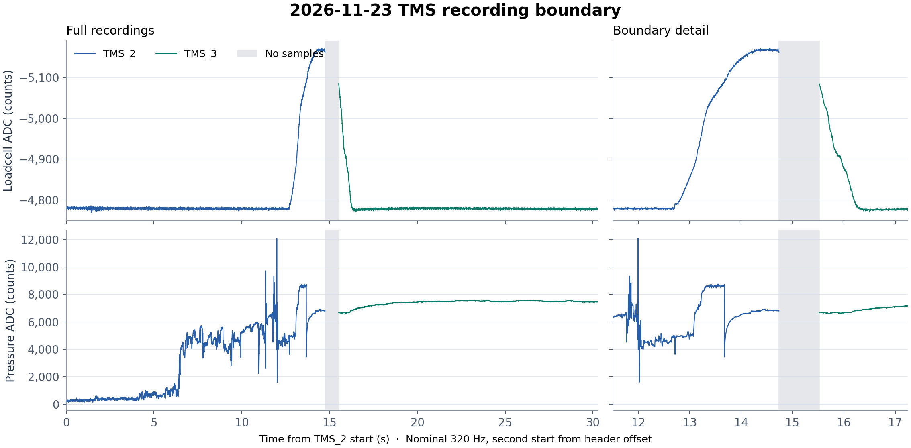

# 2026년 11월 23일 연소 시험

## 기록 종료 분석

TMS_2는 기록 시작 후 명목 **12.76초**에 로드셀 신호가 상승했고, 마지막 샘플까지 하중이 유지됐습니다. TMS_3는 하중이 걸린 상태에서 시작해 약 1초 안에 TMS_2의 상승 전 기준선으로 돌아왔습니다. 두 파일 사이에는 샘플이 없지만, 앞 파일의 상승과 뒤 파일의 하강은 한 이벤트가 기록 경계에 걸친 경우와 일치합니다.

두 파일 모두 완전한 로드셀·압력 쌍 **4,717개**와 동일한 전원 시작 시각을 기록했습니다. 헤더의 샘플링 시작 시각은 **15.519536초** 차이입니다. 파일 길이와 시작 간격은 펌웨어의 15초 기록 주기와 맞아, 로드셀 상승이 늦게 나타난 뒤 첫 기록이 정해진 시간에 닫혔을 가능성이 높습니다. 압력은 로드셀이 상승하기 전부터 변했습니다. 점화 명령 시각과 샘플별 시각이 없어 실제 점화 지연과 파일 사이 공백의 정확한 길이는 확인할 수 없습니다.

## 관측값과 분석 범위

| 항목 | 값 |
| --- | --- |
| 샘플링 시간축 | 명목 320 Hz, 각 파일 마지막 샘플 14.7375초 |
| TMS_2 추력 상승 | 3% 기준 12.759375초, 5 N 기준 12.771875초 (기록 시작 기준) |
| TMS_2 관측 최대 / 마지막 필터링 추력 | 149.17 N / 146.30 N |
| TMS_2 관측 최대 압력 | 23.281 bar. 첫 0.5초를 기준으로 보정 |
| 전체 연소 시간, 평균 추력, 총 임펄스 | 산정 불가 |

TMS_2의 파이프라인 결과는 기록 종료까지 추력이 임계값을 넘어서 잠정값입니다. TMS_3는 첫 샘플부터 하강 중이므로 파일 내에서 새로 시작하는 상승은 검출되지 않았습니다. 두 압력 채널 모두 ADC 포화·고정값 검사를 통과했습니다. 추력과 압력 변환에는 기존 보정 계수를 사용했습니다.

## 자료 파일

| 파일 | 원자료 | 파이프라인 | 그래프 |
| --- | --- | --- | --- |
| TMS_2.TXT | [원자료](./files/2026-11-23_tms-2_raw.txt) | [보고서](./files/2026-11-23_tms-2_executive_report.txt) · [처리 데이터](./files/2026-11-23_tms-2_pipeline_data.txt) · [품질 정보](./files/2026-11-23_tms-2_quality.json) | [통합](./files/2026-11-23_tms-2_combined_plot.png) · [로드셀](./files/2026-11-23_tms-2_loadcell_plot.png) · [압력](./files/2026-11-23_tms-2_barometer_plot.png) |
| TMS_3.TXT | [원자료](./files/2026-11-23_tms-3_raw.txt) | [보고서](./files/2026-11-23_tms-3_executive_report.txt) · [처리 데이터](./files/2026-11-23_tms-3_pipeline_data.txt) · [품질 정보](./files/2026-11-23_tms-3_quality.json) | [통합](./files/2026-11-23_tms-3_combined_plot.png) · [로드셀](./files/2026-11-23_tms-3_loadcell_plot.png) · [압력](./files/2026-11-23_tms-3_barometer_plot.png) |

[세션 매니페스트](./files/2026-11-23_session_manifest.json) · [경계 비교 데이터](./files/2026-11-23_comparison.json)
