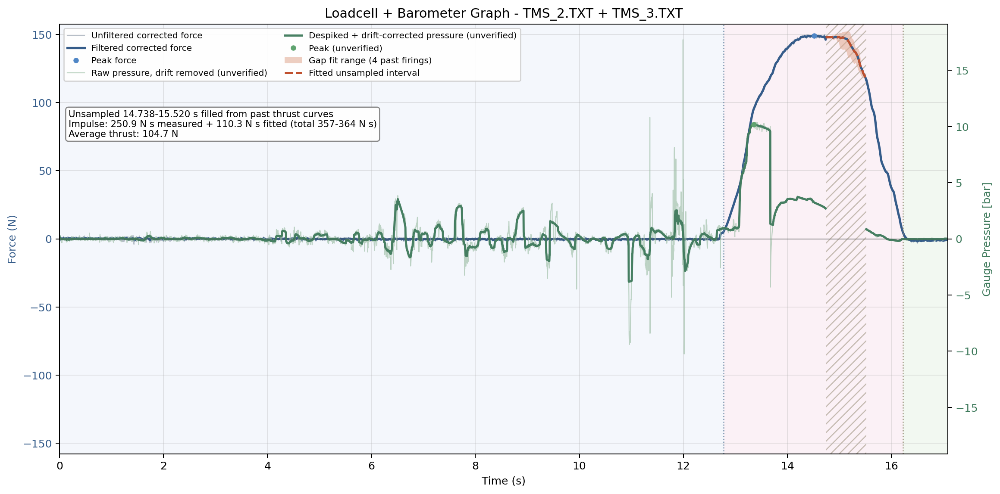
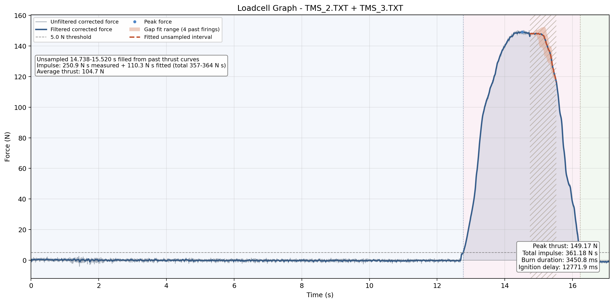
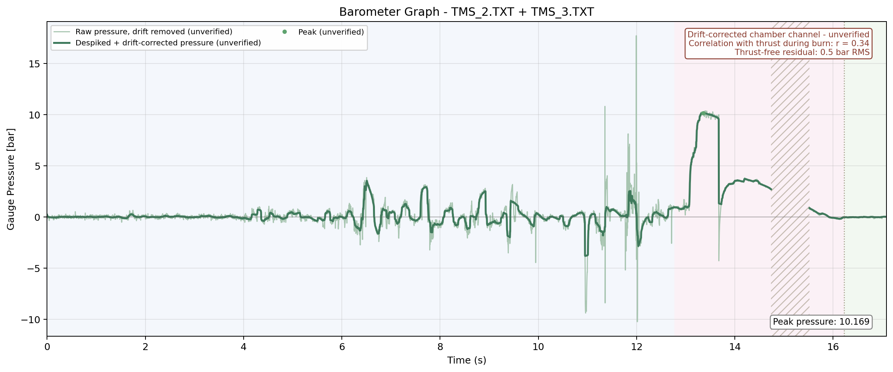

# 2026년 11월 23일 연소 시험

점화 지연이 길어 연소가 로거의 15초 기록 경계를 넘었습니다. `TMS_2`에는 점화·상승·최대 추력 구간이, `TMS_3`에는 감쇠 구간이 기록되었고 두 파일 사이 0.782 s는 기록되지 않았습니다. 이 구간은 이전 시험의 추력 곡선으로 추정했으며, 그림에서 빗금과 점선으로 표시합니다.

## Reference Figures

### Combined Plot

### Loadcell Plot

### Barometer Plot

## Metrics

| 항목 | 값 |
|---|---|
| 입력 파일 | TMS/Data/2026/11_23/TMS_2.TXT + TMS_3.TXT |
| 샘플링 속도 | 320 sps |
| 점화 지연 | 12771.9 ms (TMS_2 기록 시작 기준) |
| 연소 시간 | 3450.8 ms (5 N, 헤더 정렬) |
| 최대 추력 | 149.17 N (측정) |
| 평균 추력 | 104.66 N (추정) |
| 총 임펄스 | 361.18 N s (추정, 범위 356.88–363.55) |
| — 측정 임펄스 | 250.92 N s (TMS_2 210.70 + TMS_3 40.22) |
| — 미기록 구간 추정 | 110.26 N s (범위 105.96–112.63) |
| 최대 압력 | 10.169 bar (suspect) at 13.353 s |

측정 임펄스만으로 계산한 250.92 N s는 하한값입니다.

## 시험 조건 및 데이터 처리

| 항목 | 값 |
|---|---|
| 샘플링 속도 | 320 sps |
| 기록 파일 | TMS_2 + TMS_3; 샘플링 시작 헤더 차이로 두 번째 파일을 +15.519536 s에 배치 |
| 미기록 구간 | 14.737500 to 15.519536 s (0.782036 s) |
| 드리프트 보정 | TMS_2 기준 상수 오프셋을 두 파일에 적용 |
| 로드셀 임계값 | 5.00 N (고정 절대값) |
| 추력 필터 | Butterworth low-pass 20.0 Hz, order 2; 파일별 개별 적용 |
| 로드셀 기준 오프셋 | -60.100961 N |
| 로드셀 기준 구간 | 0.000000 to 6.387500 s (TMS_2 점화 전 raw force) |
| 연소 구간 | TMS_2의 첫 5 N 교차부터 TMS_3의 마지막 5 N 교차까지 (헤더 정렬) |
| 미기록 구간 추정 | 공백 양쪽 추력에 이전 시험 추력 곡선을 맞춤(크기·이동·시간 배율)하고 양 끝에 고정한 중앙값; 채택: 2026-04-03, 2026-04-08, 2026-05-28, 2026-10-13 (TMS_4) |
| 미기록 구간 임펄스 | 110.26 N s (범위 105.96-112.63; knee fit 110.07; 직선 연결 103.34) |
| 압력 필터 | 0.1 s 이동 중앙값(스파이크 제거) 후 드리프트 기준선 제거 |
| 압력 드리프트 기준선 | 추력 없는 구간(12.67 s 이전, 16.52 s 이후)의 0.5 s 중앙값을 잇는 PCHIP; 해당 구간 게이지 압력 0 가정 |
| 압력 검증 | 연소 중 추력과 상관 r = 0.34 (기준 0.50); 잔차 0.53 bar RMS |

### 미기록 구간 추정 템플릿

| 템플릿 | RMS 오차 | 구간 임펄스 | 채택 |
|---|---:|---:|:---:|
| 2026-04-08 | 3.48 N | 112.6 N s | 예 |
| 2026-04-03 | 5.63 N | 110.3 N s | 예 |
| 2026-05-28 | 5.63 N | 110.6 N s | 예 |
| 2026-10-13 (TMS_4) | 5.70 N | 106.0 N s | 예 |
| 2026-07-23 (TMS_7) | 6.96 N | 108.3 N s | 아니오 |
| 2026-07-16 | 9.74 N | 107.7 N s | 아니오 |
| 2026-07-24 (TMS_5) | 16.85 N | 105.3 N s | 아니오 |

`filtered_force_N`은 측정값만 담고 미기록 구간은 `nan`입니다. `analysis_force_N`은 추정 구간을 포함하며 `gap_fit_low_N`, `gap_fit_high_N`이 템플릿 범위입니다. `filtered_gauge_pressure`는 스파이크·드리프트를 제거한 압력이고 `pressure_drift_baseline_bar`는 제거한 기준선입니다.

## Calibration

| 항목 | 값 |
|---|---|
| 로드셀 보정 기울기 | -0.039100 kg/ADC |
| 로드셀 보정 절편 | -193.0049 kg |
| 로드셀 보정 R² | 0.999948 |
| 압력 변환식 | y = 0.0027x -0.11 |

## Issues

- 기록 경계: 연소가 TMS_2 종료 후에도 이어졌습니다. TMS_2와 TMS_3 사이 0.782 s(14.738-15.520 s)는 기록되지 않았으며, 이 구간은 이전 시험 추력 곡선으로 맞춤 추정했습니다(110.3 N s, 범위 106.0-112.6). 측정 임펄스만으로는 250.92 N s입니다.
- 압력 채널: 추력이 없는 6.4 s에 ADC가 약 300에서 4,500으로 계단 상승, 11.3 s·12.0 s에 스파이크, 연소 종료 후 약 19 bar 유지. 스파이크·드리프트 제거 후에도 추력이 상승하는 13.1-13.7 s에 약 10 bar로 평탄하다가 149 N 최대 추력 구간에서 2-4 bar로 떨어집니다(추력과 상관 r = 0.34). 의심 데이터로 표시하고 성능 계산에는 쓰지 않습니다.
- 시간축: 샘플별 타임스탬프가 없습니다. 실제 샘플링 속도가 320 Hz보다 낮으면 미기록 구간과 추정 임펄스 비중이 줄어듭니다.

## Test Video

- 공개된 영상 링크 없음.

## Result Files

- [Executive Report](./files/2026-11-23_tms-2-3_executive_report.txt)
- [Pipeline Data](./files/2026-11-23_tms-2-3_pipeline_data.txt) (두 기록 + 추정 구간)
- [Fit and metrics](./files/2026-11-23_tms-2-3_joint.json)
- [Session manifest](./files/2026-11-23_session_manifest.json)

### Per-recording outputs

| 기록 | 파일 |
|---|---|
| `TMS_2.TXT` | [Raw](./files/2026-11-23_tms-2_raw.txt) · [Report](./files/2026-11-23_tms-2_executive_report.txt) · [TSV](./files/2026-11-23_tms-2_pipeline_data.txt) · [Quality](./files/2026-11-23_tms-2_quality.json) · [Combined](./files/2026-11-23_tms-2_combined_plot.png) · [Loadcell](./files/2026-11-23_tms-2_loadcell_plot.png) · [Pressure](./files/2026-11-23_tms-2_barometer_plot.png) |
| `TMS_3.TXT` | [Raw](./files/2026-11-23_tms-3_raw.txt) · [Report](./files/2026-11-23_tms-3_executive_report.txt) · [TSV](./files/2026-11-23_tms-3_pipeline_data.txt) · [Quality](./files/2026-11-23_tms-3_quality.json) · [Combined](./files/2026-11-23_tms-3_combined_plot.png) · [Loadcell](./files/2026-11-23_tms-3_loadcell_plot.png) · [Pressure](./files/2026-11-23_tms-3_barometer_plot.png) |

단일 파일 분석에서 `TMS_2`는 기록 끝까지 임계값 이상이라 provisional, `TMS_3`는 첫 0.5 s가 이미 하중 상태라 no event로 판정됩니다. 성능 값은 두 기록을 함께 분석한 위 결과를 사용합니다.

## Processing provenance

Pipeline `Calibration/tms_data_pipeline.py` at TMS commit `0604925` (fixed 5 N threshold); joint analysis `Calibration/tms_split_recording.py` at commit `efd13eb`. Raw SHA-256: `TMS_2` `f09bb3697c9af0f7c748f43ee07ddb550009a55252e1710b9ef3638bb48afcae`, `TMS_3` `273e4b6c0866b2bf82153875bc0364ef8e42dd2b87614ca3af2282b7cda57226`.
